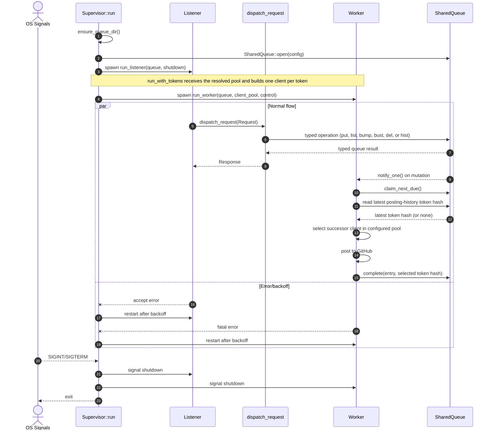
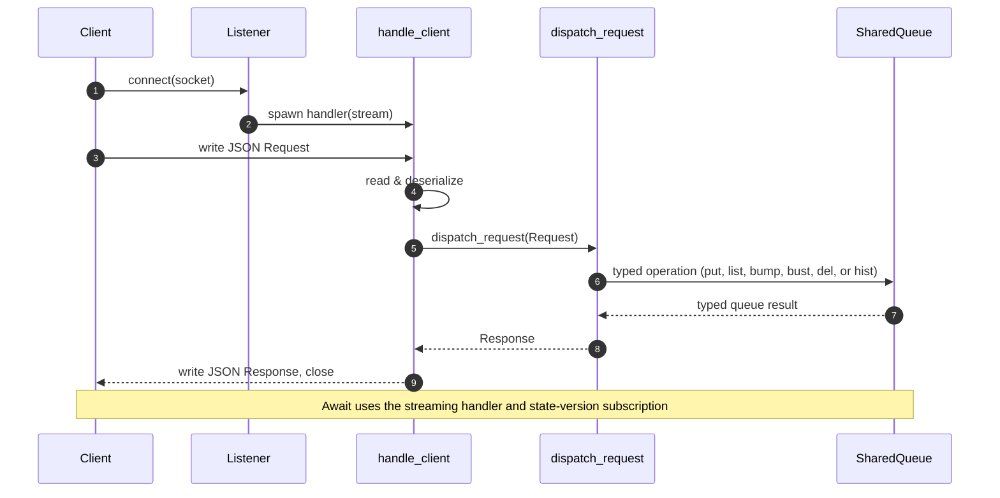
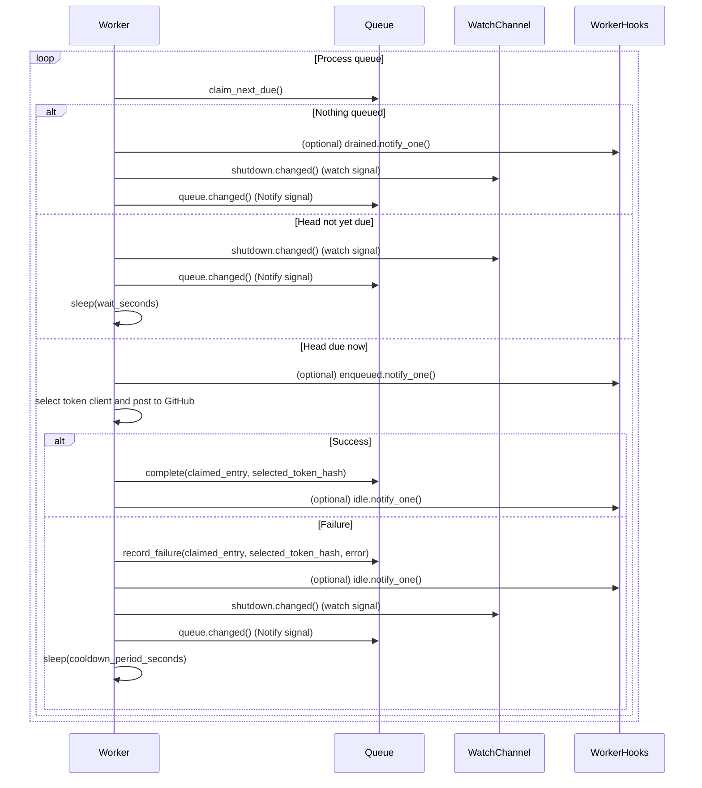

# A Fault-Tolerant GitHub Comment Queuing Service in Rust

## Section 1: System Architecture and Core Component Selection

This document presents a comprehensive architectural design and implementation
guide for `comenq`, a robust service for enqueuing GitHub Pull Request
comments. The system is designed to post comments with a mandatory cooling-off
period, a critical feature for managing interactions with GitHub's API and
avoiding secondary rate limits that penalize rapid, automated actions. The
design prioritizes reliability, security, and operational simplicity, tailored
for deployment on a resource-constrained Linux environment.

### 1.1. Architectural Overview: The Client-Daemon Model

The fundamental architecture of the `comenq` system is based on the classic
Unix client-daemon model. This design pattern is not merely a stylistic choice
but a direct and necessary consequence of the core requirement to enforce a
time-delayed, sequential processing of comments. A simple, ephemeral script
cannot maintain the state and persistence required for this task. The system is
therefore decomposed into two distinct, cooperating processes:

1. `comenqd` **(The Daemon):** A long-running background process that serves as
   the system's engine. It is solely responsible for managing a persistent job
   queue, interacting with the GitHub API, and enforcing the configured
   cooling-off period between posts.

2. `comenq` **(The Client):** A lightweight command-line interface (CLI) tool.
   Its only function is to parse user input, connect to the `comenqd` daemon,
   and submit a new comment request for queuing.

This separation of concerns, inspired by established systems like Docker which
use a daemon-client model over a Unix socket[^1], yields significant advantages:

- **Persistence and Statefulness:** The daemon can maintain the queue and its
  internal timer state across many client invocations, ensuring that the
  configured delay is consistently enforced.

- **Decoupling:** The user's interaction (via the CLI) is immediate. The user
  can submit a comment and receive confirmation that it has been enqueued
  without having to wait for it to be posted. The daemon handles the
  asynchronous processing in the background.

- **Robustness:** The daemon can be managed as a proper system service, with
  automatic restarts on failure, while the client remains a simple, stateless
  utility.

The complete lifecycle of a request is illustrated in the following sequence:

1. A user on the host machine invokes the `comenq` client via a command like
   `ssh mybox comenq put owner/repo 123 "My comment"`.

2. The `comenq` client parses the command-line arguments.

3. The client establishes a connection to the `comenqd` daemon over a local
   Unix Domain Socket (UDS).

4. The client serializes the comment data into a predefined format (JSON) and
   transmits it to the daemon.

5. The `comenqd` daemon, listening on the UDS, accepts the connection, reads
   the data, and deserializes it into a job request.

6. The daemon validates the request and pushes it onto a persistent,
   disk-backed queue.

7. The daemon immediately sends an acknowledgement of receipt back to the
   client, which then exits.

8. A separate, dedicated worker task within the daemon continuously monitors
   the queue. It dequeues one job at a time.

9. The worker task uses an authenticated client to post the comment to the
   GitHub API.

10. Upon successful posting, the worker commits the job, permanently removing
   it from the queue.

11. The worker task then enters a sleep state for the configured cooling-off
   period.

12. After the sleep period elapses, the worker task returns to step 8, ready to
   process the next job in the queue.

This architecture ensures that comment posting is strictly serialized and
paced, directly addressing the primary goal of avoiding API rate limits.

### Shared queue and concurrency

The listener and worker tasks do not communicate over a channel. Instead, both
hold an `Arc<SharedQueue>` wrapping the on-disk `QueueStore`, the daemon
configuration, and a `tokio::sync::Notify` used to wake the worker promptly
when the queue changes.

- The listener's `listener::protocol::dispatch_request` adapter maps each
  client request to a typed `SharedQueue` operation and writes the resulting
  reply before the connection closes. A request is durably persisted to disk
  before the client receives its acknowledgement, so there is no in-memory
  backlog that could be lost if the daemon exits unexpectedly.

- Mutating operations (`put`, `bump`, `bust`, `del`) call `notify_one` on the
  shared `Notify` after the change is written, so the worker interrupts any
  wait and re-evaluates the head of the queue immediately.

- Because every mutation goes straight to disk, restarting either the
  listener or the worker after a panic loses no pending requests: the store
  itself is the single source of truth, not an in-memory buffer.

### 1.2. Core Technology Stack: Crate Selection and Justification

The selection of foundational Rust libraries (crates) is critical to building a
robust and maintainable system. The following table outlines the chosen crates
for each major component of the `comenq` service, along with a detailed
justification for each selection based on an analysis of available tools and
project requirements.

<!-- markdownlint-disable MD013 -->
| Component/Concern | Selected Crate/Library | Key Features & Rationale | Alternative(s) Considered |
| -------------------- | ---------------------------- | --------------------------------------------------------------------------------------------------------------------------------------------------------------------------------------------------------------------------------------------------------------------------------------------------------------------------------------------------------------------- | ------------------------------------------------------------------------------------------------------------------------------------------------------------------------------------------------------------------------------------------------------------------------------ | -------------------- | ---------- |
| Asynchronous Runtime | tokio | The de-facto standard for asynchronous programming in Rust. It provides a high-performance, multithreaded scheduler and a comprehensive suite of utilities for I/O, networking, and timers, including the essential UnixListener, UnixStream, and time::sleep components.[^2] Its maturity and extensive ecosystem make it the definitive choice for the daemon's core. | async-std |
| CLI Argument Parsing | clap | The most popular and feature-rich CLI argument parsing library for Rust.[^3] The | derive feature offers an exceptionally ergonomic and declarative way to define the CLI's structure, automatically generating argument parsing, validation, and help text from a simple struct definition.[^3] | argh, pico-args 4 |
| GitHub API Client | octocrab | A modern, actively maintained, and extensible GitHub API client.[^5] It provides strongly typed models for API responses and a builder pattern for requests, simplifying interaction with the GitHub REST API. Its static API and support for custom middleware are valuable for building robust clients.[^3] | roctokit 12, manual | reqwest 13 |
| Persistent Queue | bespoke `QueueStore` (`comenqd::store`) | A disk-backed store using one JSON file per pending entry, `last_post` and `last_attempt` markers, and an append-only `history.jsonl` posting log. Entry updates use atomic write-then-rename. Unlike an append-only queue, it supports reordering (`bump`, `bust`) and removal (`del`) of arbitrary entries, and only deletes an entry after a confirmed post, giving an "at-least-once" delivery guarantee. | yaque (rejected: append-only, cannot reorder or delete arbitrary entries) |
| IPC Serialization | serde / serde_json | serde is the universal framework for serialization and deserialization in Rust. serde_json provides a straightforward implementation for the JSON data format, which is chosen for its human-readability (aiding in debugging) and widespread support. | bincode, prost |
| Systemd Integration | systemd (crate) | Provides native Rust bindings for interacting with the systemd journal and daemon notification APIs.[^8] While the primary deployment mechanism is a | .service file, this crate can be used for more advanced integration, such as sending readiness notifications. | systemctl (crate) 20 |
| Logging | tracing / tracing-subscriber | A modern, structured, and asynchronous-aware logging and diagnostics framework. It is the standard choice for tokio-based applications, providing contextual information that is superior to traditional line-based logging. | log / env_logger 22 |
| |
<!-- markdownlint-enable MD013 -->

## Section 2: Design of the `comenq` CLI Client

The `comenq` client is designed to be a simple, robust, and user-friendly tool.
Its sole responsibility is to capture the user's intent from the command line
and relay it securely to the `comenqd` daemon. The implementation will leverage
`clap` for argument parsing and `tokio` for asynchronous communication over the
Unix Domain Socket.

### 2.1. Defining the Command-Line Interface with `clap`

The command-line interface is the primary point of interaction for the user. A
well-designed CLI is intuitive and self-documenting. The `clap` `derive` macro
defines the entire CLI structure declaratively within a Rust `struct`,
providing clarity and maintainability compared to the more verbose builder
pattern.[^3]

The CLI has a global optional `--socket` override (also available through
`COMENQ_SOCKET`) and seven subcommands: `put`, `list`, `bump`, `bust`, `del`,
`await`, and `hist`. `put` accepts `<owner/repo> <pr_number> <comment_body>`
and an optional `--now`; the other commands accept no positional arguments
(`list`) or an eight-character entry identifier (`bump`, `bust`, `del`, and
`await`). `hist` accepts an optional `-n` or `--limit` count. Clap does not bind
`COMENQ_SOCKET` as an argument environment variable, so `--help` does not show
`[env: COMENQ_SOCKET]`; the client resolves the variable at execution time
through its injected environment provider.

The following code shows the shape of the shipped `Args` parser and its
subcommands. The implementation delegates protocol and socket work to the
client module.

```rust
// crates/comenq/src/lib.rs

use clap::{Parser, Subcommand};
use std::path::PathBuf;

/// A CLI client to enqueue a comment for a GitHub Pull Request.
#[derive(Debug, Parser)]
#[command(name = "comenq")]
pub struct Args {
    /// Path to the daemon's Unix Domain Socket.
    ///
    /// `COMENQ_SOCKET` is resolved at execution time, not during parsing.
    #[arg(long, global = true)]
    pub socket: Option<PathBuf>,

    /// Queue operation to perform.
    #[command(subcommand)]
    pub command: Command,
}

#[derive(Debug, Subcommand)]
pub enum Command {
    /// Enqueue a comment.
    Put {
        repo_slug: RepoSlug,
        pr_number: u64,
        comment_body: String,
        #[arg(long)]
        now: bool,
    },
    List,
    Bump { id: String },
    Bust { id: String },
    Del { id: String },
    Await { id: String },
    Hist {
        #[arg(short = 'n', long, value_name = "LIMIT")]
        limit: Option<usize>,
    },
}
```

The `#[derive(Parser)]` and `#[derive(Subcommand)]` attributes instruct `clap`
to generate all the necessary parsing logic.[^5] The doc comments (`///`) are
automatically converted into help messages, which are displayed when the user
runs `comenq --help`. This feature makes the tool self-documenting.[^10]

`#[arg(...)]` and `#[command(...)]` attributes define the global socket
override and subcommand fields. Socket discovery itself is resolved at connect
time, so the client can try the user runtime socket before the system socket.

### 2.2. Client-Daemon IPC Protocol

Each Unix domain socket connection carries one JSON-encoded `Request`. For
ordinary operations, the client writes the complete request and shuts down its
write side; the daemon deserializes it, sends one JSON-encoded `Response`, then
closes the connection. `await` is the streaming exception: after the client
half-closes, the daemon sends newline-delimited JSON `AwaitEvent` frames until
one terminal `posted` or `error` frame, then closes the connection. The shared
protocol types are defined in `src/protocol.rs`; `CommentRequest` in
`src/lib.rs` is the payload nested inside a `put` request, not a standalone
wire message.

`Request` is tagged by its `op` field, with variant names serialized in
snake_case. `put` contains a `request` object with `owner`, `repo`,
`pr_number`, and `body`; its optional `immediate` field defaults to `false`.
`list` has no additional fields. `bump`, `bust`, and `del` each contain an `id`
string. `await` contains an eight-character hexadecimal `id`; it is read-only
and does not change queue or worker state. `hist` accepts an optional `limit`
and continuation cursor, and returns `history` records in chronological pages
over a fixed log snapshot. A successful response is tagged with
`"outcome":"ok"` and may contain an `entry` (for `put`), `entries` (for
`list`), or `history` (for `hist`). A history response includes `next_cursor`
when more records remain. A failed response is tagged with `"outcome":"error"`
and contains a human-readable `message`. Absent payload fields are omitted.

The JSON is sent over a `tokio::net::UnixStream`. A Unix Domain Socket (UDS) is
used for local IPC:

- **Performance:** For local Inter-Process Communication (IPC), UDS bypasses
  much of the TCP/IP stack overhead, resulting in lower latency and higher
  throughput.

- **Security:** This is the most critical advantage. A UDS is an entity in the
  filesystem, like a file.[^12] This means it is subject to standard Unix
  filesystem permissions (

  `chmod`, `chown`). The `comenqd` daemon can create the socket with
  permissions that restrict write access to a specific user or group. This
  provides a simple, powerful, and OS-integrated security model, preventing
  unauthorized local users or processes from injecting comments into the queue.
  This is inherently more secure than a `localhost` TCP socket, which any local
  user could connect to by default.

### 2.3. Historical Client Implementation Blueprint

The following historical pseudocode shows the earlier single-purpose client's
argument parsing and asynchronous IPC. The shipped client uses the subcommand
and protocol flow described in Section 2.4; this block is retained only to
explain the original design.

```rust
// In src/bin/comenq/main.rs

use clap::Parser;
use std::path::PathBuf;
use std::process;
use tokio::io::AsyncWriteExt;
use tokio::net::UnixStream;

use tracing::warn;
use comenq::RepoSlug;

// Assume CommentRequest is in a shared library: `use comenq_lib::CommentRequest;`
// For this example, we define it here.
use serde::{Deserialize, Serialize};

#[derive(Debug, Serialize, Deserialize)]
pub struct CommentRequest {
    pub owner: String,
    pub repo: String,
    pub pr_number: u64,
    pub body: String,
}

/// A CLI client to enqueue a comment for a GitHub Pull Request.
#[derive(Debug, Parser)]
pub struct Args {
    /// The repository in 'owner/repo' format (e.g., "rust-lang/rust").
    #[arg(long)]
    repo_slug: RepoSlug,

    /// The pull request number to comment on.
    #[arg(long)]
    pr_number: u64,

    /// The body of the comment. It is recommended to quote this argument.
    #[arg(long)]
    comment_body: String,

    /// Path to the daemon's Unix Domain Socket.
    #[arg(long)]
    socket: PathBuf,
}

#[tokio::main]
async fn main() {
    // 1. Parse command-line arguments using clap's derive macro.
    let args = Args::parse();

    // 2. Construct the request payload. The slug has already been validated
    //    and split by `clap`.
    let request = CommentRequest {
        owner: args.repo_slug.owner().to_owned(),
        repo: args.repo_slug.repo().to_owned(),
        pr_number: args.pr_number,
        body: args.comment_body,
    };

    // 3. Serialize the request to JSON.
    let payload = match serde_json::to_vec(&request) {
        Ok(p) => p,
        Err(e) => {
            eprintln!("Error: Failed to serialize request: {}", e);
            process::exit(1);
        }
    };

    // 5. Connect to the daemon's Unix Domain Socket.
    let mut stream = match UnixStream::connect(&args.socket).await {
        Ok(s) => s,
        Err(e) => {
            eprintln!("Error: Could not connect to the comenqd daemon at {:?}.", args.socket);
            eprintln!("Details: {}", e);
            eprintln!("Please ensure the daemon is running and you have the correct permissions.");
            process::exit(1);
        }
    };

    // 6. Write the entire payload to the stream.
    if let Err(e) = stream.write_all(&payload).await {
        eprintln!("Error: Failed to send data to the daemon: {}", e);
        process::exit(1);
    }

    // 7. Gracefully shut down the write side of the stream.
    if let Err(e) = stream.shutdown().await {
        warn!("failed to close connection: {e}");
    }

    println!("Successfully enqueued comment for PR #{} on {}/{}.", request.pr_number, request.owner, request.repo);
}
```

This client is a self-contained, robust utility. It provides clear error
messages for common failure modes, such as an invalid repository slug or the
inability to connect to the daemon, guiding the user toward a resolution.

The production code exposes a `run` function in the `comenq` crate. This logic
resides in a dedicated `client` module to keep the argument parser focused. The
binary parses the CLI arguments and delegates to `run`, allowing the test suite
to exercise the network code directly. Any failures to serialize the request or
communicate with the daemon are surfaced via a small `ClientError` enumeration.
The repository slug is converted into a structured `RepoSlug` during argument
handling, so `run` operates on validated data without rechecking it.

### 2.4. Client Subcommands and ETA Semantics

The historical blueprint above shows a client that only enqueues a comment. The
shipped client exposes seven subcommands, all sharing a global `--socket` flag
(also settable via the `COMENQ_SOCKET` environment variable):

- `comenq put <owner/repo> <pr_number> <comment_body>`: enqueues a comment and
  prints its identifier and an approximate ETA, e.g.
  `Queued 1a2b3c4d for octocat/hello-world#7 — posts in ~1h 01m`. By default
  the comment waits one full cooldown (plus its flutter) from enqueue even when
  the queue is idle; `--now` lifts that floor so the comment posts as soon as
  the queue allows.

- `comenq list`: prints one line per pending comment, in posting order, each
  showing the identifier, the ETA, the target `owner/repo#pr`, and the comment
  body collapsed to a single line of at most 60 characters (control characters,
  including newlines, become spaces; longer bodies are truncated with an
  ellipsis).

- `comenq bump <id>`: moves the identified comment to the head of the queue.

- `comenq bust <id>`: moves the identified comment to the tail of the queue.

- `comenq del <id>`: removes the identified comment from the queue.

- `comenq hist [-n|--limit <limit>]`: prints the posting-history log, oldest
  first, one line per record: the identifier, the age of the attempt (e.g.
  `2m 30s ago`, or `just now`), the outcome (`ok` or `FAIL`), the first eight
  characters of the posting token's hash, the target `owner/repo#pr`, and the
  comment body collapsed to a single line of at most 60 characters. Failed
  attempts append a one-line, em-dash-separated description of the error.
  Records are always shown in chronological order (oldest first); `--limit`
  restricts the output to the most recent `N` records without changing that
  ordering. If no attempts have been recorded, the client prints
  `No posting history recorded.` instead of a table.

- `comenq await <id>`: waits in the foreground until the identified comment is
  posted, then writes the full GitHub comment URL (including its comment
  fragment) as one line on stdout. While it is queued, the client writes
  newline-terminated countdown reports to stderr. It exits successfully once
  the daemon confirms the post; a broken stdout pipe does not change that
  status. Daemon errors, timeouts and lost connections fail the command.
  Disconnecting or interrupting the client leaves the queue unchanged.

The `<id>` must contain exactly eight hexadecimal characters. An unknown ID
fails before the first countdown. A failed posting attempt remains queued and
is retried after a full cooldown; `await` continues waiting through the retry.
Deletion, daemon shutdown or connection loss fails the wait, as does a legacy
successful history record without a stored comment URL. Interrupting the client
only drops its connection, so a later `await` can still report a post.

For example, a countdown line on stderr can be `2m 30s remaining`; after the
post, stdout contains the full URL:
`https://github.com/owner/repo/issues/123#issuecomment-456`.

Each subcommand maps directly to one variant of the `Request` enum (see §3.2
for the store and §5 for the wire protocol). The client follows history cursors
until the snapshot is complete, then renders the records; ordinary commands
print their confirmation or the daemon's error message after one reply. `await`
uses the streaming protocol described in §5.3.

**Await countdown.** The first `waiting` frame produces a countdown report
immediately on stderr. Later reports are newline-terminated and follow this
cadence, capped at the current non-zero remaining ETA with a one-second
minimum. At zero ETA the client reports `due now` no more than once per minute
while it waits for a terminal frame:

| Remaining ETA     | Report interval |
| ----------------- | --------------- |
| Up to 60 s        | 10 s            |
| 61 s to 10 min    | 30 s            |
| 10 min 1 s to 1 h | 2 min           |
| 1 h 1 s to 6 h    | 10 min          |
| More than 6 h     | 30 min          |

Non-zero countdowns use the same `format_eta` conventions as `put` and `list`,
followed by `remaining`; zero is rendered as `due now`. Each report updates
from the latest daemon ETA and elapsed time. The client allows 5 s for its
first complete frame and 45 s between later frames.

**ETA semantics.** The estimated time until posting shown by `put` and `list`
reflects three rules enforced by the daemon:

- **Flutter is fixed at enqueue time.** When a comment is enqueued, a random
  flutter duration (up to `cooldown_flutter_seconds`) is sampled once and
  stored with the entry. It does not change on subsequent `list` calls, so the
  reported ETA for a given entry decreases as time passes. Queue mutations such
  as `bump`, `bust`, and `del` can reorder predecessors, so the scheduler
  recomputes an entry's ETA and it may increase or decrease after a mutation.

- **The cooldown always runs in full.** The daemon never shortens
  `cooldown_period_seconds` to catch up; each entry's projected posting time is
  its predecessor's projected posting time plus a full cooldown plus its own
  flutter (or, for the head entry, the last successful post plus a full
  cooldown plus its own flutter). This keeps the reported ETA consistent with
  what the worker will actually do.

- **A fresh comment waits a cooldown by default.** A default `put` records a
  `not_before` floor of its enqueue time plus one full cooldown plus its own
  flutter, so even an idle queue paces a new comment. `put --now` sets no
  floor, restoring the previous behaviour of posting as soon as the queue
  allows. An entry never posts before the later of its floor and its
  chain-projected due time, so `bump` cannot circumvent the floor.

## Section 3: Design of the `comenqd` Daemon

The `comenqd` daemon is the heart of the system. It is a stateful,
asynchronous, long-running process responsible for all interactions with the
persistent queue and the GitHub API. Its design is centred around the `tokio`
runtime to handle concurrent operations efficiently.

### 3.1. The Asynchronous Core and Task Structure

The daemon's architecture is built on `tokio`'s cooperative multitasking model.
Upon startup, the `main` function will initialize necessary resources
(configuration, logger, queue) and then spawn two primary, independent
asynchronous tasks that run concurrently for the lifetime of the daemon:

1. **Listener** (`run_listener`): This task is the daemon's public-facing
   interface. It binds to the UDS and listens for incoming connections from
   `comenq` clients. For each connection, it reads one JSON `Request`; ordinary
   requests receive one JSON `Response`, while `await` streams progress and a
   terminal outcome before closing the connection.

2. **Worker** (`run_worker`): This is the main worker task. It operates in a
   loop, recomputing the head entry's due time on every iteration, waiting
   until that entry is due (or until the queue changes, or shutdown is
   signalled), posting the comment to GitHub, and recording the post before
   moving on to the next entry.

This concurrent design ensures that the daemon remains responsive to new client
requests even while the worker task is in its long sleep phase. A request can
be accepted, persisted, and acknowledged in milliseconds, while the worker task
independently processes the queue at its own deliberate pace.

Both tasks share the queue through an `Arc<SharedQueue>` rather than a channel:
there is no intermediate queue-writer task. The listener performs each mutation
directly, and the worker is woken (via a `tokio::sync::Notify`) whenever a
mutation occurs.

Both the listener and the worker are supervised. If either task exits
unexpectedly, the daemon logs the failure, waits using an exponential backoff
with jitter (via the `backon` crate) to avoid a tight restart loop, and then
respawns the task. The minimum delay between restarts is configurable via
`restart_min_delay_ms`. This keeps the service available without relying on an
external process supervisor. Because both tasks operate on the same on-disk
store rather than an in-memory buffer, restarting either task after a panic
does not discard any pending request.

The supervision and restart behaviour is illustrated in the sequence diagram
below.



### 3.2. The Persistent Job Queue: `comenqd::store::QueueStore`

A core requirement for the daemon is fault tolerance. If the daemon or the
entire server restarts, pending comments must not be lost. This rules out
simple in-memory queues like `std::collections::VecDeque` and necessitates a
disk-backed, persistent solution.

An earlier design used the `yaque` crate, an append-only, transactional,
disk-backed queue. `yaque` was rejected once the client gained `bump`, `bust`,
and `del` operations: an append-only queue has no way to reorder or delete an
arbitrary entry, only to dequeue from the head. The daemon therefore uses a
bespoke store, `comenqd::store::QueueStore`, built directly on plain files.

`QueueStore` keeps one JSON file per pending comment under
`<queue_path>/entries`, plus a `<queue_path>/last_post` file recording the Unix
time of the most recent successful post and a `<queue_path>/history.jsonl` file
recording every posting attempt, successful or failed (see "The posting history
log" below). A `<queue_path>/last_attempt` file records the most recent failed
attempt and keeps retry ETAs paced across daemon restarts. Each entry (a
`StoredEntry`) carries:

- **A deterministic eight-character identifier.** This is the first eight hex
  digits of a 64-bit FNV-1a hash computed over the request's owner, repo, PR
  number, and body, together with the second at which it was enqueued. The
  identifier is therefore stable across daemon restarts, and an identical
  request repeated within the same second is idempotent: `put` returns the
  existing entry unchanged rather than creating a duplicate.

- **An explicit integer ordering key.** New entries are appended after the
  current tail. `bump` sets the key to one less than the current head's key (or
  leaves it unchanged if the entry is already the head); `bust` sets it to one
  more than the current tail's key. Repeated bumps or busts can drive the key
  negative or arbitrarily large; entries are always read back sorted by
  `(order, enqueued_at, id)`.

- **The flutter sampled at enqueue time.** A random duration up to
  `cooldown_flutter_seconds` is chosen once, when the entry is created, and
  stored with it. Fixing the flutter at enqueue time keeps the ETA reported to
  the client stable for the entry's whole life, rather than jittering on every
  `list`.

- **The enqueue time**, used both as a tiebreaker for ordering and as an input
  to the identifier hash.

- **An optional in-flight claim token.** The worker writes a claim while
  holding the store lock, then releases the lock before posting to GitHub.
  Startup clears claims left by an interrupted worker. `bump` and `bust` may
  reorder a claimed entry without changing the active claim; `del` removes it.
  Token-checked completion does not remove a replacement entry.

Entries are written to a temporary sibling file and then renamed into place, so
a reader never observes a half-written entry. `bump`, `bust`, and `del` mutate
or remove a single entry file the same way. New entries carry a persisted
incarnation identifier so an `await` lookup stays bound to one lifetime even
when the deterministic eight-character ID is reused. The store reserves 57
bytes for this UUID field when migrating legacy entries and rejects admission
before migration if an entry or the queue lacks that space. `complete` first
writes a durable `completion` recovery record containing the entry identifier,
claim token, posting time, full comment URL in the history record, and
history-log offset. It then idempotently appends the successful attempt, clears
a superseded deletion marker, removes the matching claimed entry, atomically
rewrites `last_post`, and clears the recovery record. `QueueStore::open`
reconciles a record left by an interrupted completion and clears abandoned
claims before the worker schedules entries. A completion for an entry deleted
or replaced during the external post still records the successful post time,
but cannot delete a replacement with a different claim.

The store also keeps a marker under `await-deletions/<id>` when an entry is
deleted. It records the deleted entry's incarnation. A successful completion
clears a marker only when it belongs to that incarnation or to a currently
queued successor, so an older in-flight completion cannot erase a newer
deletion. A no-cursor `await` lookup treats a remaining marker as the latest
identifier lifetime and returns unknown instead of exposing an older success.
Startup removes markers for identifiers that are queued again, because the
pending entry then takes precedence. These markers do not appear in the `hist`
protocol or CLI.

The store admits at most 1,024 pending entries and caps total accounted queue
data at 32 MiB. Accounting includes each regular entry file's raw bytes plus
its remaining mutation reservation. New puts reserve up to 80 bytes each;
existing valid entries' remaining reservation is derived from the serialized
widths of their mutable `order` and `claim_token` fields and, for legacy
entries, the missing incarnation field. Claim, ordering and incarnation updates
consume that reservation, and writes preserve the remaining aggregate headroom.
A new `put` is rejected before persistence if its serialized entry would exceed
2 MiB minus the 80-byte reservation, or if it would exceed the aggregate
budget. On startup, the daemon fails closed if the number of existing regular
`.json` files exceeds 1,024, or their raw bytes plus remaining reservations
exceed 32 MiB. It also fails closed if a valid entry lacks enough room below
the 2 MiB per-file cap for every reachable `order`, `claim_token` or
incarnation mutation. Startup leaves these files untouched; an operator must
remove or repair the excess data before restarting. Reads accept files up to 2
MiB; oversized or corrupt files are logged and skipped by `entries()`, provided
the startup count and aggregate-size checks pass. Their raw bytes still count
towards the aggregate admission budget.

The `list` response contains at most 1,024 scheduled entries, and client and
daemon response bodies are limited to 2 MiB. If the complete ordered list would
exceed the response limit, the daemon returns an error rather than a partial
list. Scheduling and list construction enforce the entry and byte bounds before
building the response.

Because an entry is only removed from disk after a successful post
(`complete`), and a failed post simply leaves the entry in place for the next
attempt, the store preserves the same "at-least-once" delivery guarantee that
motivated the original choice of `yaque`, without its append-only limitation.

The queue is initialized at a configurable path (e.g., `/var/lib/comenq/queue`)
and stores the `CommentRequest` struct defined in the shared library as part of
each entry.

**The posting history log.** Alongside `entries` and `last_post`, the store
appends one JSON line per posting attempt to `<queue_path>/history.jsonl` (JSON
Lines: append-only, one record per line). Each `HistoryRecord` carries the
entry's `id` (the identifier it had while queued), `posted_at` (Unix seconds),
`success`, the `comment_url` for new successful records, an `error` description
(present only when `success` is false), `token_hash` (the hex SHA-256 of the
token value that made the attempt), and the `request` that was posted or
attempted. New records also retain the entry's persisted incarnation, which
distinguishes lifetimes when an identifier is reused. Older records without a
URL or incarnation remain readable; an `await` for a legacy success without a
URL returns an explicit error. Hashing rather than naming the token means
rotation state survives token-file renames, and the log never holds a secret.
Each record also has an attempt ID used to make successful completion recovery
idempotent. A successful post is recorded before `complete` removes the entry
from the queue and updates `last_post`. A failed post is recorded on every
retry attempt, since the entry stays queued and is retried after a cooldown
rather than being removed; each attempt therefore contributes its own failure
record. Writing the history record on the failure path can itself fail (e.g. a
full disk); the worker logs that error but never lets it interrupt the retry
loop, so a history-logging fault cannot stall comment posting. Appending
repairs a missing final line delimiter before the next record. When the log is
read back (to serve the `hist` protocol operation), malformed and oversized
lines are skipped with an error log. Reads return bounded pages and use a fixed
end offset so concurrent appends cannot change the records covered by an
in-progress CLI request. The listener limits each encoded page to the 2 MiB
protocol response cap.

**Round-robin token selection.** When `github_token_files` configures multiple
tokens, the worker reads the most recent history record and uses the successor
of its token hash in configured order, wrapping to the first token after the
last. Empty history or an unrecognized hash starts with the first token. With a
single token from `github_token`, `github_token_file`, or a one-element
`github_token_files`, the same selection rule always chooses that token. The
selection function accepts only token hashes, not API clients, so the rotation
policy remains independent of Octocrab. If history cannot be read, the worker
logs the failure and attempts the first configured token.

### 3.3. The UDS Listener and Request Ingestion (`run_listener`)

This task is responsible for handling all client communication. It will be
implemented as an asynchronous function spawned by the main `tokio` runtime.

Its workflow is as follows:

1. **Prepare the Socket:** `prepare_listener` binds a uniquely named temporary
   socket in the configured path's parent directory, sets its mode to `0o660`,
   then atomically renames it over the configured path.[^2] It enforces mode
   `0o660` again after the rename.

2. **Accept Loop:** The task enters an infinite `loop`, waiting for new client
   connections via `listener.accept().await`.[^13]

3. **Spawn Connection Handler:** To ensure the listener is never blocked, upon
   accepting a new connection, it immediately spawns a new, short-lived `tokio`
   task (`handle_client`) to handle that specific client.

4. **Handle Client:** This per-client task reads at most 1 MiB within
   `CLIENT_READ_TIMEOUT_SECS` (default: 5 s); larger or slower requests are
   rejected with a timeout or size error. The `MAX_REQUEST_BYTES` and
   `CLIENT_READ_TIMEOUT_SECS` limits are compile-time constants that can be
   adjusted. It deserializes the received JSON into a `Request`. Ordinary
   requests go to `listener::protocol::dispatch_request`, which maps them to a
   typed `SharedQueue` operation and returns one `Response` before connection
   closure. `Await` is routed to a read-only streaming handler. A
   listener-owned semaphore caps concurrent waiters at 64; each frame write has
   a 5 s deadline. Responses are capped at 2 MiB on both client and daemon, and
   `list` returns at most 1,024 entries. If the complete list exceeds the
   response cap, the daemon returns an error rather than a partial response.
   Persisted entry reads accept files up to 2 MiB. Up to 80 bytes per entry are
   reserved for metadata growth, and the store admits at most 32 MiB of file
   bytes plus remaining reservations. A request that fails to deserialize
   receives an error `Response` rather than a silently dropped connection.

An `await` connection receives NDJSON frames, each no larger than 64 KiB
including its newline. While the selected entry remains queued, the handler
sends `waiting` frames with the current ETA at least every 15 s. It ends with
exactly one `posted` frame containing the full comment URL or one `error` frame
for an unknown or removed entry, shutdown, full waiter capacity (64 connected
waiters), a legacy success without a URL, a URL too large for the frame limit,
or a store read failure. The client enforces a 45 s deadline between complete
frames. Waiters subscribe to a queue-state version signal before lookup,
separately from the worker's `Notify`, so waiting cannot consume or delay a
worker wake-up. The queue exposes an opaque `AwaitToken` and application-level
change subscription; history offsets, incarnation matching, and Tokio's watch
receiver remain inside their adapters. Waiters recheck after state changes and
on heartbeats, and hold no store lock while writing. Lookup checks the pending
entry first, then history. Its first pending result retains an internal history
byte offset and persisted entry incarnation; later lookups use both to bind
completion to that queued lifetime, even if the eight-character identifier is
reused. A no-cursor history scan runs on a blocking task outside the queue
mutex. The queue rechecks pending state and its generation after the scan,
retrying when a put or completion changed the snapshot.

The pending ETA uses the same list scheduling projection. The projection is
cached under the store mutex for each state version and clock second, so many
waiters do not repeatedly rebuild an unchanged schedule. The
`comenqd_await_schedule_cache_total` metric counts cache `hit`, `rebuild`, and
`invalidation` outcomes. Await metrics use bounded outcome and store-error
categories, including `posted_url_too_large`; identifiers and comment URLs are
never metric labels or structured error fields.

This design makes the request ingestion process highly concurrent and robust,
capable of handling multiple simultaneous client connections without impacting
the worker loop. Because each request is executed and persisted before the
reply is sent, there is no intermediate queue-writer stage to lose data if the
listener is later restarted.

The interaction between the client, listener, and shared queue is shown in the
sequence diagram below.



### 3.4. The GitHub Comment-Posting Worker (`run_worker`)

This task implements the core business logic of the service. It runs in a loop,
ensuring that comments are processed one by one with the required delay.

#### 3.4.1. `octocrab` Initialization and API Usage

The daemon builds one `octocrab` client for each token in the configured pool.
It resolves and validates the pool during configuration loading, then carries
the owned token values through startup so client construction does not reopen
the files. A single inline or file-based Personal Access Token (PAT) remains a
one-client pool.

A critical detail for a successful implementation is using the correct GitHub
API endpoint. While one might intuitively look for a "create comment" method
within the Pull Request API, general comments on a PR are, in fact, considered
part of the underlying Issue. This non-obvious fact is highlighted in GitHub's
own documentation patterns.[^7] Therefore, the correct

`octocrab` method to use is `issues().create_comment()`, not a method on the
`pulls()` handler.[^15]

The correct invocation will be:

```rust
octocrab.issues("owner", "repo").create_comment(pr_number, "body").await?;
```

#### 3.4.2. The Worker Workflow

The worker task's loop consists of the following steps:

1. **Compute and claim the due entry:** It calls
   `queue.claim_next_due()`, which recomputes the schedule and atomically
   records a claim for a due head entry under the store lock. The lock is
   released before the GitHub request. A `bump`, `bust`, `del`, or new `put`
   during a deferred wait wakes the worker to recompute the schedule. During a
   post, a claimed entry cannot be selected a second time; `bump` and `bust`
   preserve the claim, and `del` removes the entry.

2. **Wait until due:** If nothing is queued, the worker waits for the shared
   queue's change signal or a shutdown signal. If the head entry is not yet
   due, the worker sleeps for the remaining time, but the sleep is
   interruptible: a queue change (e.g. a `bump` promoting a different entry) or
   shutdown wakes it early, and it loops back to recompute the due entry rather
   than blindly posting whichever entry it started waiting for.

3. **Post Comment:** Once an entry is due, the worker constructs and sends the
   API request to GitHub using the `octocrab` client and the data from the
   entry.

4. **Handle Result:**

   - **On API Success:** The task calls `queue.complete()` with the claimed
     entry and selected token's hash. A durable completion record stores that
     hash before the matching entry is removed and `last_post` is updated. If a
     concurrent `del` already removed the entry, or the ID now belongs to a
     replacement, completion records the successful post without deleting the
     replacement.
     It then logs the successful post.

   - **On API Failure:** The task logs the error from the GitHub API. The
     entry is left in place (`complete` is never called for it), so it is
     retried on a later iteration. The worker waits a full
     `cooldown_period_seconds` before retrying, to avoid hammering a
     persistently failing API. Queue-change notifications do not shorten this
     retry deadline; they are consumed while the worker continues waiting. For
     more advanced error handling, a retry counter could be added to the
     `CommentRequest` to prevent infinite loops
     for unfixable errors, eventually moving the job to a "dead-letter" queue.

5. The loop then repeats.

**ETA projection.** The store computes, for each pending entry, an estimated
number of seconds until it is posted (`schedule` in `QueueStore`). The head
entry is due no earlier than its `not_before` floor. A normal `put` sets that
floor to its enqueue time plus one full `cooldown_period_seconds` and its
sampled flutter; immediate posting without an earlier schedule applies only to
`put --now` (and entries persisted before the floor was introduced). When a
previous post exists, the head also respects the last successful post plus a
full cooldown and its own flutter. Each subsequent entry is due a further
cooldown plus its own flutter after its predecessor's projected posting time,
while still respecting its own `not_before` floor. Because flutter is sampled
once at enqueue time and the cooldown always runs in full, the ETA reported to
a client by `put` or `list` matches what the worker will actually do, subject
to queue mutations recomputing predecessor order.

This workflow gives a highly resilient system that can tolerate both network
failures and process crashes without losing data: an entry is only ever removed
from the store once GitHub has confirmed the post.

### 3.5. Daemon Configuration and Logging

For operational flexibility and security, the daemon's behaviour must be
controlled via a configuration file, not hard-coded values. A TOML file located
at `/etc/comenqd/config.toml` is the conventional choice.

| Parameter                | Type           | Description                                                                                                                                                                                                                | Default Value                                                                                                  |
| ------------------------ | -------------- | -------------------------------------------------------------------------------------------------------------------------------------------------------------------------------------------------------------------------- | -------------------------------------------------------------------------------------------------------------- |
| github_token             | String         | The GitHub Personal Access Token (PAT) used for authentication. Required unless `github_token_file` or `github_token_files` is set.                                                                                        | (none)                                                                                                         |
| github_token_file        | PathBuf        | Optional path to a file containing the PAT. Read at startup; its trimmed contents override `github_token`. A leading `${VAR}` placeholder is expanded from the environment, enabling systemd `LoadCredential` integration. | (none)                                                                                                         |
| github_token_files       | `Vec<PathBuf>` | Optional ordered paths, each containing one PAT. When non-empty, neither single-token setting is required; the worker rotates among these tokens. Each file is read and validated at startup.                              | (empty)                                                                                                        |
| socket_path              | PathBuf        | The filesystem path for the Unix Domain Socket.                                                                                                                                                                            | `$XDG_RUNTIME_DIR/comenq/comenq.sock` when a user runtime directory is available, else /run/comenq/comenq.sock |
| queue_path               | PathBuf        | The directory path for persistent queue data (`entries/`, `last_post`, `last_attempt`, `history.jsonl`, and the `completion` recovery record, managed by `QueueStore`).                                                    | /var/lib/comenq/queue                                                                                          |
| cooldown_period_seconds  | u64            | The configurable cooling-off period in seconds after each comment post; it also determines the base used for ETA projections shown by `put` and `list`.                                                                    | 960                                                                                                            |
| cooldown_flutter_seconds | u64            | Maximum random flutter in seconds, sampled when each comment is enqueued and stored with its entry. It only lengthens the cooldown-derived ETA; zero disables flutter.                                                     | 0                                                                                                              |
| github_api_timeout_secs  | u64            | Maximum duration in seconds for a GitHub API call; configurable with this setting or `--github-api-timeout-secs`.                                                                                                          | 30                                                                                                             |
| restart_min_delay_ms     | u64            | The minimum delay (milliseconds) applied between supervised task restarts (backoff floor).                                                                                                                                 | 100                                                                                                            |

Configuration is loaded using the `ortho_config` crate. The daemon binary calls
`Config::load_with_tokens()`, which merges values from
`/etc/comenqd/config.toml`, `COMENQD_*` environment variables, and any supplied
CLI arguments. CLI arguments have the highest precedence, followed by
environment variables, and finally the configuration file. Environment reads go
through an injected `mockable::Env` provider, using `DefaultEnv` in production.
The `COMENQD_*` layer is enumerated through a separate OS-string port
(`std::env::vars_os` in production) rather than `mockable::Env::all`, because
that method collects through `std::env::vars` and panics on any non-Unicode
entry; a single unrelated byte-valued variable would otherwise abort startup.
Documented `COMENQD_<FIELD>` names are matched without regard to case, as the
previous Figment provider did; the upper-case spelling wins if several casings
are present. The client reads `COMENQ_SOCKET` through an OS-string accessor so
a socket path that is not valid UTF-8 is honoured. The `${VAR}` token-path
expansion uses the same provider. Missing optional fields are replaced with
defaults. The daemon socket default is resolved through the provider and sits
below the file layer; direct Serde deserialization without `socket_path` falls
back to the system path without reading the process environment. A non-Unicode
`XDG_RUNTIME_DIR` is treated as absent, so the system socket is used.
Configuration fails unless it can resolve either a non-empty
`github_token_files` pool or a usable single token. A non-empty
`github_token_files` pool takes precedence over the single-token settings;
every listed file is checked at startup. Otherwise, `github_token_file` is read
at startup and its trimmed contents take precedence over the configured token
unless `--github-token` is supplied. Invalid TOML also results in a
configuration error. The daemon binary passes the owned, resolved token pool to
`daemon::run_with_tokens()` for client construction, so it does not read the
token files again during startup.

Logging verbosity is controlled by the `RUST_LOG` environment variable, not a
daemon configuration field. Robust logging is non-negotiable for a background
process. The `tracing` crate with `tracing-subscriber` will be used to provide
structured, asynchronous logging. Key events to be logged include:

- Daemon startup and shutdown.

- Configuration loaded.

- New client connection accepted.

- New comment request successfully enqueued.

- Attempting to post a comment to a specific PR.

- Comment successfully posted (including the URL of the new comment).

- GitHub API call failed (including the error details).

- Entering and exiting the cooldown period.

When run as a `systemd` service, these logs will be automatically captured by
the system's journal, making them easily accessible for administrators via
`journalctl`.

## Section 4: Deployment and Operationalization

A well-designed application is only useful if it can be deployed and managed
reliably. This section provides a practical guide to installing, configuring,
and running the `comenqd` daemon as a robust system service on a modern Linux
distribution using `systemd`.

### 4.1. Compilation and Installation

First, the project should be compiled in release mode to produce optimized
binaries.

```bash
# From the root of the Rust project workspace
cargo build --release
```

After a successful build, the resulting binaries must be installed to standard
locations in the filesystem. A simple installation script would perform the
following actions:

```bash
#!/bin/bash
set -e

# Install binaries
install -D -m 755 target/release/comenq /usr/local/bin/comenq
install -D -m 755 target/release/comenqd /usr/local/sbin/comenqd

# Create a dedicated, non-login user for the daemon
# The -r flag creates a system user
if ! id -u comenq >/dev/null 2>&1; then
    useradd -r -s /usr/sbin/nologin -d /var/lib/comenq -c "comenq Daemon User" comenq
fi

# Create necessary directories
mkdir -p /etc/comenqd
mkdir -p /var/lib/comenq/queue
mkdir -p /run/comenq

# Set ownership
chown -R comenq:comenq /var/lib/comenq
chown -R root:comenq /etc/comenqd
chown -R comenq:comenq /run/comenq

# Set permissions for config directory
chmod 770 /etc/comenqd

echo "Installation complete. Please create /etc/comenqd/config.toml"
```

This script establishes the necessary user and directory structure with
security in mind, ensuring the daemon runs with the principle of least
privilege.

### 4.2. Creating a `systemd` Service Unit

Running the daemon directly in a terminal is suitable for development but not
for production. A `systemd` service unit file automates the daemon's lifecycle
management, including startup on boot, automatic restarts on failure, and
integration with the system's logging infrastructure.[^16]

The following `comenq.service` file should be placed in `/etc/systemd/system/`:

Ini, TOML

```ini
[Unit]
Description=GitHub Comment Enqueuing Daemon
Documentation=https://github.com/your-repo/comenq
After=network.target


# Service execution
Type=simple
User=comenq
Group=comenq
ExecStart=/usr/local/sbin/comenqd --config /etc/comenqd/config.toml

# Automatic restart
Restart=on-failure
RestartSec=10s

# Hardening
# See: systemd.exec(5)
PrivateTmp=true
ProtectSystem=strict
ProtectHome=true
NoNewPrivileges=true
PrivateDevices=true
ProtectKernelTunables=true
ProtectKernelModules=true
ProtectControlGroups=true
RestrictAddressFamilies=AF_UNIX AF_INET AF_INET6
RestrictRealtime=true

[Install]
WantedBy=multi-user.target
```

**Analysis of Directives:**

- `User=comenq`, `Group=comenq`: Ensures the process runs as the unprivileged
  `comenq` user.

- `Restart=on-failure`: Instructs `systemd` to automatically restart the daemon
  if it exits with a non-zero status code (e.g., due to a panic).

- **Hardening Directives:** The block of `Protect*` and `Restrict*` directives
  significantly sandboxes the process, limiting its access to the host system.
  For example, `ProtectSystem=strict` makes most of the OS filesystem read-only
  to the daemon, and `PrivateTmp=true` gives it a private `/tmp` directory.
  These are modern best practices for securing system services.

Once the file is in place, the service can be enabled and started:

```bash
# Reload systemd to recognize the new service file
sudo systemctl daemon-reload

# Enable the service to start on boot
sudo systemctl enable comenq.service

# Start the service immediately
sudo systemctl start comenq.service

# Check the status of the service
sudo systemctl status comenq.service
```

#### 4.2.1. Running as a per-user service

The daemon also runs unprivileged under `systemd --user`, using the
`packaging/linux/comenqd-user.service` unit and the matching example
configuration `packaging/config/comenqd-user.toml`:

- The socket defaults to `$XDG_RUNTIME_DIR/comenq/comenq.sock`;
  `RuntimeDirectory=comenq` provisions the directory. Without an explicit
  override, the client tries this user socket first and then
  `/run/comenq/comenq.sock` if the user-socket connection fails.
- The queue lives in `~/.local/state/comenq/queue`, provided through
  `StateDirectory=comenq` and the `COMENQD_QUEUE_PATH` environment variable in
  the unit.
- The PAT is supplied through the systemd credential system:
  `LoadCredential=token:%h/.config/comenqd/token` exposes the token file to the
  service, and the configuration references it as
  `github_token_file = "${CREDENTIALS_DIRECTORY}/token"`, keeping the secret
  out of the unit, the environment, and `ps` output.

Install the unit as `~/.config/systemd/user/comenqd.service`, the configuration
as `~/.config/comenqd/config.toml`, then enable it with
`systemctl --user enable --now comenqd.service`.

### 4.3. Security Posture and Best Practices

Security is a primary consideration in the design and deployment of this
service.

- **GitHub Token Security:** The GitHub Personal Access Token is the most
  sensitive piece of information. It must be created with the minimum necessary
  scopes (e.g., `public_repo` if only public repositories are targeted, or
  `repo` for private ones). The configuration file containing this token,
  `/etc/comenqd/config.toml`, must have its permissions strictly controlled:

```bash
  sudo touch /etc/comenqd/config.toml
  sudo chown root:comenq /etc/comenqd/config.toml
  sudo chmod 640 /etc/comenqd/config.toml
  
```

This ensures that only the `root` user and members of the `comenq` group can
read the file. Since the daemon runs as `comenq`, it can read its
configuration, but other unprivileged users on the system cannot.

- **Filesystem Permissions:** The permissions set by the installation script
  are crucial:

  - `/var/lib/comenq`: The daemon's state directory is owned exclusively by
    `comenq`, preventing other users from tampering with the persistent queue.

  - `/run/comenq/comenq.sock`: The UDS is created in a directory also owned by
    `comenq`. The daemon should create the socket with permissions `0o660`,
    allowing read/write access for the `comenq` user and group. Other users on
    the system who are not in the `comenq` group will be denied access at the
    filesystem level, providing a robust and simple authentication mechanism
    for the client.

By adhering to these deployment and security practices, `comenq` transitions
from a piece of software into a well-behaved, secure, and manageable system
service.

### 4.4. Packaging and Release Workflow

To simplify installation, the project now relies on the composite actions
published in `leynos/shared-actions`. The release workflow iterates over the
`comenq` client and `comenqd` daemon for both the x86_64 and aarch64 GNU/Linux
targets. `rust-build-release` provisions the correct Rust toolchain, compiles
the workspace in release mode, and stages the man pages that each crate's build
script copies from `packaging/man`. Packaging responsibility sits with the
shared `linux-packages` helper, which the workflow now invokes directly to
generate the transient `nfpm` manifest and emit `.deb` and `.rpm` artefacts for
every matrix entry. The workflow uploads those artefacts to a draft GitHub
Release via `softprops/action-gh-release`, preserving the manual review gate
that existed in the GoReleaser-based flow. macOS support remains deferred, so
the workflow targets Linux only.

## Section 5: Complete Source Code and Project Manifest

This final section provides the complete source code and project configuration,
enabling a developer to build, install, and run the `comenq` service
immediately.

### 5.1. Project Structure

The project is organized as a Rust workspace to facilitate code sharing between
the client and daemon binaries.

```text
comenq-project/
├── Cargo.toml
├── src/
│   └── lib.rs         # Shared library (comenq-lib)
├── crates/
│   ├── comenq/
│   │   ├── Cargo.toml
│   │   └── src/
│   │       └── main.rs  # Client binary
│   └── comenqd/
│       ├── Cargo.toml
│       └── src/
│           └── main.rs  # Daemon binary
└──.gitignore
```

### 5.2. `Cargo.toml` Manifest

This is the root `Cargo.toml` for the workspace.

Ini, TOML

```toml
[workspace]
members = [
    "crates/comenq",
    "crates/comenqd",
]
resolver = "2"

[workspace.dependencies]
tokio = { version = "1.35", features = ["full"] }
clap = { version = "4.4", features = ["derive"] }
serde = { version = "1.0", features = ["derive"] }
serde_json = "1.0"
octocrab = "0.38"
rand = "0.9"
uuid = { version = "1", features = ["v4"] }
backon = "1.5"
tracing = "0.1"
tracing-subscriber = { version = "0.3", features = ["env-filter"] }
anyhow = "1.0"
thiserror = "1.0"

[profile.release]
lto = true
codegen-units = 1
strip = true
panic = "abort"
```

### 5.3. Current Client-Daemon Protocol

The wire contract is defined by `Request` and `Response` in `src/protocol.rs`.
`CommentRequest` in `src/lib.rs` supplies the `request` payload for `put`; it
is not sent by itself. These examples show the tagged JSON shape for every
request operation:

```json
{
  "op": "put",
  "request": {
    "owner": "owner",
    "repo": "repo",
    "pr_number": 123,
    "body": "Comment body"
  },
  "immediate": false
}
{"op":"list"}
{"op":"bump","id":"1a2b3c4d"}
{"op":"bust","id":"1a2b3c4d"}
{"op":"del","id":"1a2b3c4d"}
{"op":"await","id":"1a2b3c4d"}
{"op":"hist","limit":20}
```

Replies use one tagged `Response` per connection. `put` replies include an
`entry`, `list` replies include `entries`, and `hist` replies include `history`
and a `next_cursor` when more records remain. Other successful operations return
`{"outcome":"ok"}`, and failures return `{"outcome":"error","message":"..."}`.

`await` instead streams one JSON object per line. For example, while an entry
is pending and then after GitHub accepts the comment, the daemon may send:

```json
{"status":"waiting","eta_seconds":61}
{"status":"waiting","eta_seconds":46}
{"status":"posted","comment_url":"https://github.com/owner/repo/issues/123#issuecomment-456"}
```

The terminal `posted` frame carries the full comment URL. A terminal
`{"status":"error","message":"..."}` frame reports an unknown or removed entry,
shutdown, full capacity (64 connected waiters), a legacy success without a URL,
a URL too large for the frame limit, or a store read failure. Each frame is
newline-terminated, includes its newline in the 64 KiB limit, and is written
with a 5 s deadline. The daemon sends a waiting heartbeat every 15 s while
idle. The client allows 5 s for the first complete frame and 45 s between later
frames. It renders `waiting` ETAs as newline-terminated countdown lines on
stderr and writes only the full posted comment URL to stdout. For a store
lookup failure, the client receives `await lookup failed (<category>)` while
the daemon log retains the detailed error.

### 5.4. Historical Source for `comenq` (Client)

The following is historical pseudocode for the original single-purpose client;
it is not the shipped implementation. The current client uses the seven
subcommands described in Section 2.4 and sends tagged `Request` values, then
handles a `Response` or an `AwaitEvent` stream from the daemon.

```rust
// Historical pseudocode for crates/comenq/src/main.rs
use clap::Parser;
use std::path::PathBuf;
use std::process;
use tokio::io::AsyncWriteExt;
use tokio::net::UnixStream;
use comenq_lib::CommentRequest; // Using the shared library
use tracing::warn;
use comenq::RepoSlug;

// The shipped parser is in crates/comenq/src/lib.rs; transport is in
// crates/comenq/src/client.rs.
struct Args {
    repo_slug: RepoSlug,
    pr_number: u64,
    comment_body: String,
    socket: PathBuf,
}

#[tokio::main]
async fn main() {
    let args = Args::parse();

    let request = CommentRequest {
        owner: args.repo_slug.owner().to_owned(),
        repo: args.repo_slug.repo().to_owned(),
        pr_number: args.pr_number,
        body: args.comment_body,
    };

    let payload = match serde_json::to_vec(&request) {
        Ok(p) => p,
        Err(e) => {
            eprintln!("Error: Failed to serialize request: {}", e);
            process::exit(1);
        }
    };

    let mut stream = match UnixStream::connect(&args.socket).await {
        Ok(s) => s,
        Err(e) => {
            eprintln!("Error: Could not connect to the comenqd daemon at {:?}.", args.socket);
            eprintln!("Details: {}", e);
            process::exit(1);
        }
    };

    if let Err(e) = stream.write_all(&payload).await {
        eprintln!("Error: Failed to send data to the daemon: {}", e);
        process::exit(1);
    }

    if let Err(e) = stream.shutdown().await {
        warn!("failed to close connection: {e}");
    }

    println!("Successfully enqueued comment for PR #{} on {}/{}.", request.pr_number, request.owner, request.repo);
}
```

### 5.5. Source Code for `comenqd` (Daemon)

The `crates/comenqd/Cargo.toml` would list the workspace dependencies. The
daemon source is more complex, integrating all components.

At a high level, the daemon:

- loads configuration and initializes logging
- spawns a Unix socket listener for incoming requests
- starts the worker with [`run_worker`](../crates/comenqd/src/worker.rs),
  controlled by [`WorkerControl`](../crates/comenqd/src/worker.rs)
- supervises the listener and worker concurrently, restarting failures with
  jittered exponential backoff
- turns SIGINT or SIGTERM into a shared shutdown signal. Each supervisor waits
  up to 100 ms for its task to stop, then aborts it if needed; `tokio::join!`
  waits for both supervisors to finish

See [`supervisor::run`](../crates/comenqd/src/supervisor.rs) for the daemon
startup and shutdown flow. The worker accepts a `WorkerControl` that carries
the shutdown signal and optional test hooks.

The sequence diagram in Figure&nbsp;1 illustrates how the worker interacts with
the queue, shutdown channel, and optional hooks.



Figure&nbsp;1: Worker lifecycle interactions. `WorkerHooks` rely on
[`Notify`](https://docs.rs/tokio/latest/tokio/sync/struct.Notify.html) with
edge semantics, so tests must await notifications with explicit timeouts to
avoid missed wakes. Always wait for notifications using a timeout pattern
because the notifier may fire before the waiter starts listening.

### 5.6. Implementation Notes

The repository initializes the workspace with `comenq-lib` at the root and two
binary crates under `crates/`. `CommentRequest` and the `protocol` module
(`Request`/`Response`) reside in the library and derive both `Serialize` and
`Deserialize`. The daemon now spawns a Unix socket listener and queue worker as
described above. Structured logging is initialized using `tracing_subscriber`
with JSON output controlled by the `RUST_LOG` environment variable. The queue
directory is created asynchronously on start if it does not already exist,
before `QueueStore::open` runs in a blocking task and reads or creates the
`entries` subdirectory within it. There is no dedicated queue-writer task or
inter-task channel: the listener and worker both hold an `Arc<SharedQueue>`,
which wraps the store in a `std::sync::Mutex`. `SharedQueue` runs each
synchronous store operation in `spawn_blocking`, preserving single-writer
semantics without blocking Tokio runtime threads. `QueueStore::open` also
reconciles any durable `completion` record before the worker can schedule
entries.

The worker's cooling-off period is configured via `cooldown_period_seconds`,
which defaults to 960 seconds. This value is the base interval used for the ETA
projections returned by `put` and `list` and provides ample headroom against
GitHub's secondary rate limits.

GitHub API calls are wrapped in `tokio::time::timeout` with a configurable
limit (default 30 seconds) to ensure the worker does not block indefinitely if
the network stalls. The limit can be overridden via the
`github_api_timeout_secs` configuration or the `--github-api-timeout-secs` CLI
flag.

## Works cited

[^1]: A simple UNIX socket listener in Rust | Kyle M. Douglass. Accessed on
      July 24, 2025.
      <http://kmdouglass.github.io/posts/a-simple-unix-socket-listener-in-rust/>
[^2]: UnixSocket in tokio::net - Docs.rs. Accessed on July 24, 2025.
      <https://docs.rs/tokio/latest/tokio/net/struct.UnixSocket.html>
[^3]: Picking an argument parser - Rain's Rust CLI recommendations. Accessed on
      July 24, 2025.
      <https://rust-cli-recommendations.sunshowers.io/cli-parser.html> Accessed
      on July 24, 2025. <https://rust-cli.github.io/book/tutorial/cli-args.html>
[^5]: clap - Docs.rs. Accessed on July 24, 2025.
      <https://docs.rs/clap/latest/clap/>
      <https://docs.rs/clap/latest/clap/_derive/_tutorial/index.html>
[^7]: XAMPPRocky/octocrab: A modern, extensible GitHub API Client for Rust.
      Accessed on July 24, 2025. <https://github.com/XAMPPRocky/octocrab>
[^8]: octocrab/examples/custom_client.rs at main - GitHub. Accessed on July 24,
      2025.
      <https://github.com/XAMPPRocky/octocrab/blob/main/examples/custom_client.rs>
[^10]: clap derive reference - Docs.rs. Accessed on July 24, 2025.
       <https://docs.rs/clap/latest/clap/_derive/index.html>
[^12]: Unix sockets, the basics in Rust - Emmanuel Bosquet. Accessed on July
       24, 2025. <https://emmanuelbosquet.com/2022/whatsaunixsocket/>
[^13]: Example of reading from a Unix socket · Issue #9 · tokio-rs/tokio-uds -
       GitHub. Accessed on July 24, 2025.
       <https://github.com/tokio-rs/tokio-uds/issues/9> 24, 2025.
       <http://docs2.lfe.io/guides/working-with-comments/>
[^15]: PullRequestHandler in octocrab::pulls - Docs.rs. Accessed on July 24,
       2025.
       <https://docs.rs/octocrab/latest/octocrab/pulls/struct.PullRequestHandler.html>
[^16]: KillingSpark/rustysd: A service manager that is able to run
       "traditional" systemd services, written in rust - GitHub. Accessed on
       July 24, 2025. <https://github.com/KillingSpark/rustysd>
